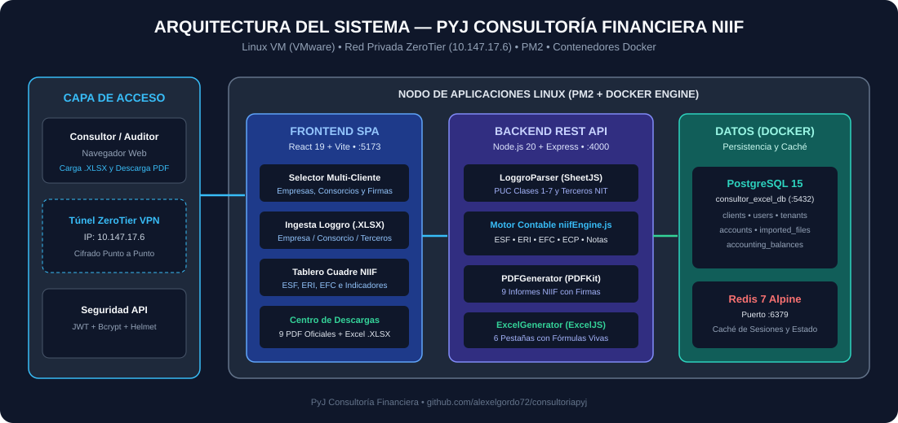
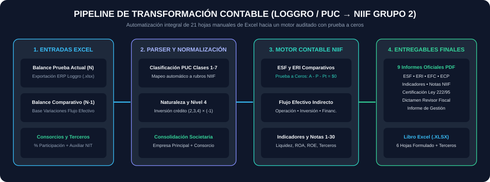
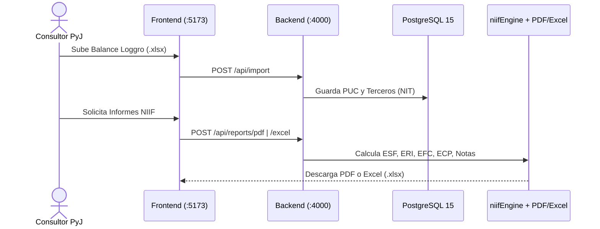
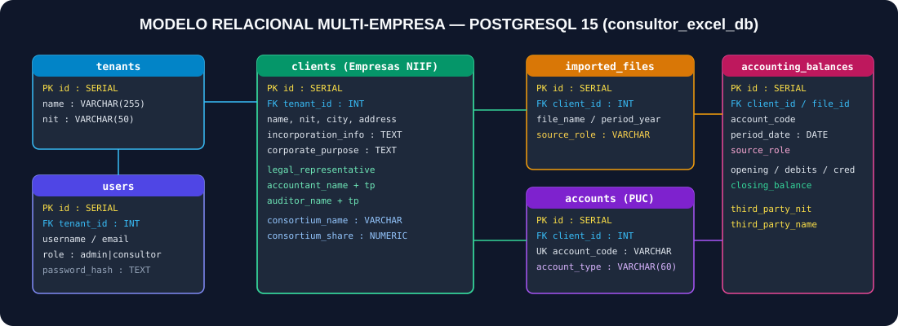

# 📊 PyJ Consultoría Financiera — Sistema Automatizado NIIF

**Plataforma web multi-cliente para procesar Balances de Prueba (Loggro / PUC Colombia), consolidar consorcios, desglosar terceros y generar los 9 informes oficiales NIIF para Pymes más libro Excel formulado.**

---

## 🎯 Propósito y Solución Implementada

**PyJ Consultoría Financiera** reemplaza los libros manuales de Excel de 21 hojas por un flujo web auditado y reproducible:

1. **Gestión Multi-Empresa (`clients`):** Registro de cada empresa con NIT, objeto social, porcentaje de consorcio y firmas oficiales (Representante Legal, Contador Público y Revisor Fiscal).
2. **Ingesta Directa Loggro (`loggroParser.js`):** Procesa balances crudos (año actual, comparativo, consorcio y terceros con NIT), normalizando signos débito/crédito sin duplicar niveles PUC.
3. **Motor Contable NIIF (`niifEngine.js`):** Calcula Balance Nivel 4, ESF, ERI, Flujo de Efectivo Indirecto, Cambios en Patrimonio, Indicadores y Notas 1 a 30 con prueba a ceros (`A - P - Pt = $0`).
4. **Entregables Instantáneos:** Descarga en un clic los **9 informes oficiales en PDF** y el **libro Excel consolidado (`.xlsx`)** con 6 pestañas formuladas.

---

## 🏗️ Arquitectura General del Sistema

| Capa | Tecnología | Puerto / Nodo | Responsabilidad Técnica |
| :--- | :--- | :--- | :--- |
| **Frontend SPA** | React 19 + Vite 8 | `:5173` (`serve`) | Selector global de cliente, alta de empresas, carga multi-origen y descarga de informes. |
| **Backend API** | Node.js 20 + Express 4 | `:4000` (REST API) | Autenticación JWT, parseo Excel (`xlsx`), motor NIIF, PDF (`pdfkit`) y Excel (`exceljs`). |
| **Base de Datos** | PostgreSQL 15 (Docker) | `:5432` (`consultor_excel_db`) | Persistencia relacional aislada por `client_id` para cuentas PUC, saldos y terceros. |
| **Caché & Estado** | Redis 7 Alpine (Docker) | `:6379` | Gestión de sesiones y estado de procesamiento. |
| **Red & Procesos** | ZeroTier VPN + PM2 | `10.147.17.6` | Acceso cifrado punto a punto y alta disponibilidad de procesos Node.js. |

---
## ⚙️ Pipeline Contable (`PUC → NIIF`)

---

## 🗄️ Modelo de Datos y Matriz PUC → NIIF

| Rango PUC | Rubro Contable | Estado | Nota | Signo |
| :--- | :--- | :--- | :---: | :--- |
| `1105`–`1255` | Efectivo, Bancos e Inversiones CP | ESF Activo Cte | **4** | Débito (`+`) |
| `1305`–`1399` | Clientes y Otras CxC CP | ESF Activo Cte | **5** | `+` y Terceros |
| `1355` | Anticipo de Impuestos y Retenciones | ESF Activo Cte | **6** | Débito (`+`) |
| `1405`–`1499` | Inventarios y Provisiones | ESF Activo Cte | **7** | Débito (`+`) |
| `1504`–`1592` | Propiedades, Planta y Equipo (Neto) | ESF No Cte | **8** | Costo - Deprec. |
| `1325`,`16xx`,`17xx` | Deudores LP, Intangibles y Anticipados | ESF No Cte | **9–10** | Débito (`+`) |
| `2105`–`2195` | Obligaciones Financieras CP y LP | ESF Pasivo | **11, 15** | Crédito (`× -1`) |
| `2205`–`2815` | Proveedores y Acreedores CP y LP | ESF Pasivo | **12, 16** | `× -1` y Terceros |
| `2365`–`2525` | Impuestos y Obligaciones Laborales | ESF Pasivo Cte | **13–14** | Crédito (`× -1`) |
| `3105`–`3905` | Capital, Reservas y Resultados | ESF / ECP | **17–19** | Patrimonio |
| `41xx` / `61xx`–`74xx` | Ingresos Ordinarios y Costos | ERI | **20** | Ingresos (`× -1`) |
| `51xx`–`5405` | Gastos Admin, Ventas, Financ. y Renta | ERI | **21–26** | Débito (`+`) |

---

## 📦 Paquete de 10 Entregables por Cliente

1. **ESF (PDF):** Estado de Situación Financiera consolidado y comparativo.
2. **ERI (PDF):** Estado de Resultados Integral.
3. **EFC (PDF):** Estado de Flujos de Efectivo (Método Indirecto).
4. **ECP (PDF):** Estado de Cambios en el Patrimonio.
5. **Indicadores Financieros (PDF):** Liquidez, endeudamiento, ROA, ROE y márgenes.
6. **Notas NIIF (PDF):** Notas 1 a 30 con desglose por terceros (NIT y saldo).
7. **Certificación (PDF):** Art. 37 Ley 222 de 1995 con firmas legales.
8. **Dictamen Revisor Fiscal (PDF):** Informe bajo NIA 700.
9. **Informe de Gestión (PDF):** Art. 47 Ley 222 de 1995 y Ley 603 de 2000.
10. **Libro Excel (`.xlsx`):** 6 pestañas con fórmulas activas y `Detalle_Terceros`.

---

## 👨‍💻 Autor

**Alexander Mosquera Fajardo** — [@alexelgordo72](https://github.com/alexelgordo72)  
*Ingeniería de Datos e Inteligencia Artificial — Universidad Autónoma de Occidente*  
*Consultor en Sistemas de Información Empresarial, Arquitectura de Software y Analítica Financiera*
